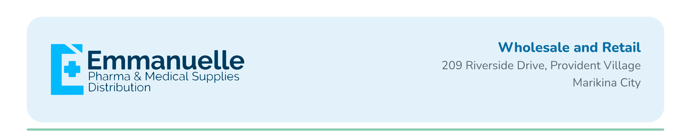

# Emmanuelle Pharma & Medical Supplies

Publications, signage and print for Emmanuelle Pharma & Medical Supplies. Brand rules live in the [Emmanuelle Design System](https://claude.ai/artifact/BZ3eubu2p5WSvJiqvA3wCV). Part of [Brand Media](../README.md).

**Vibe:** relaxing and soothing. Calm sky blue and cream, soft shapes, gentle sentence-case copy, no emoji or loud caps.
**Page:** [facebook.com/emedsupplies](https://www.facebook.com/emedsupplies/)
**Page line:** We provide Affordable and Reliable Medical Equipment for all your Home and Corporate Needs
**Hashtag:** #masmurakayemman
**Rules:** no em dashes in any copy. Scheduling does not use Metricool.

## Social posts

| Date | Publication | Branch | Status | Preview |
| --- | --- | --- | --- | --- |
| | None yet | | | |

## Signage & print

| Date | Piece | Location | Status | Preview |
| --- | --- | --- | --- | --- |
| 2026-10-12 | [Government letterhead](print/2026-10-letterhead-government/print.md) | Government level | Draft |  |
| 2026-10-12 | [Brand letterhead](print/2026-10-letterhead-brand/print.md) | Brand level | Draft |  |

## Brand kit

- [`brand/guidelines`](brand/guidelines): brand guide and colour/type tokens from the design system
- [`brand/logos`](brand/logos): vectorized logos (SVG for print, PNG for quick use) and originals
- [`brand/fonts`](brand/fonts): Nunito and Nunito Sans (free Google Fonts, OFL licence); Nunito font files (400, 700, 800)

**Colours:** Brand sky `#0E97DB` · Brand deep `#0A6FA6` · Cream `#F6F4EE` · Sage `#8CCBB0` · Ink `#25323F`
**Rules:** never white text on brand sky; buttons and contact bars use brand deep.

## Folder guide

- `posts/YYYY-MM-DD-slug/`: feed (1080×1350) and story (1080×1920) PNGs plus `post.md` with captions
- `print/YYYY-MM-slug/`: print-ready PDFs at actual size, mockups and `print.md`
- `brand/`: logos, fonts and guidelines
