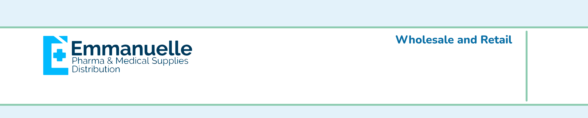
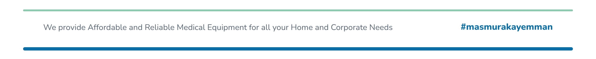

# Emmanuelle Pharma Brand Letterhead

| | |
| --- | --- |
| Date | Oct 12, 2026 |
| Type | Print, letterhead template (header and footer images) |
| Location | Brand level, facebook.com/emedsupplies |
| Status | Draft |
| Design | Emmanuelle Design System (Nunito, cream, sky, sage, brand deep). Logo vectorized from the supplied landscape file. Source: [source.html](source.html) |

Brand level letterhead. Uses the same logo as the [government letterhead](../2026-10-letterhead-government/print.md). Soft rounded mist panel, sage line, Wholesale and Retail, page line and #masmurakayemman in the footer. Contact: 0917-512-5050, sales.emedsupplyph@gmail.com.

Revamped Oct 13, 2026 to the repo letterhead format: [LETTERHEAD-SPEC.md](../../../LETTERHEAD-SPEC.md). First page header keeps Zone A (branch tag) and Zone B (phone, email, address) blank because the system prints them, the logo ends above y 350, and only the optional tagline sits at the top right.

## Files

| Piece | Size | File |
| --- | --- | --- |
| First page header | 2480 × 500 px | [PNG](emmanuelle-brand-letterhead-header-first-page-2480x500.png) |
| Later pages header (slim band) | 2480 × 250 px | [PNG](emmanuelle-brand-letterhead-header-later-pages-2480x250.png) |
| Footer (every page) | 2480 × 250 px | [PNG](emmanuelle-brand-letterhead-footer-2480x250.png) |

## Preview

