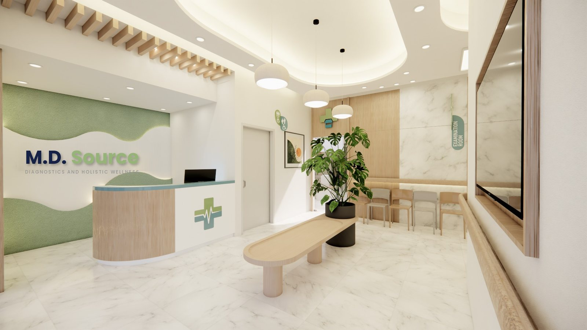
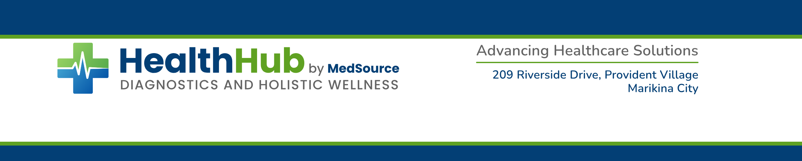

# HealthHub by MedSource

Healthcare brand of MedSource HealthHub (sister company of MedSource). Design system: [MedSource HealthHub Design System](https://claude.ai/artifact/9rBBbMZtz8yim7BnH17PUR). Colours: navy #033F75, green #5FA122, grey #646464, flat only (gradients stay inside the logo). Fonts: Nunito (text, taglines), Quicksand (display); the supplied logo keeps its own Poppins lettering. Tagline: Advancing Healthcare Solutions.

Letterhead format: [LETTERHEAD-SPEC.md](../LETTERHEAD-SPEC.md). No em dashes.

## Print

| Date | Title | Status | Preview |
| --- | --- | --- | --- |
| 2026-10-27 | [YAKAP Proposal for Sta. Lucia Mall](print/2026-10-yakap-proposal-sta-lucia/presentation.md) (M.D. Source, 33-slide deck) | Approved |  |
| 2026-10-15 | [HealthHub by MedSource government letterhead](print/2026-10-healthhub-letterhead-government/print.md) | Draft |  |
| 2026-10-13 | [HealthHub by MedSource letterhead](print/2026-10-healthhub-letterhead/print.md) | Draft |  |

## Brand files

Official logo: HealthHub by MedSource. All SVGs are fully vector (text outlined from Poppins, no fonts needed), with 0.5X clear space built in (X = wordmark cap height). The cross is the vector cross from the design system's assets.

- `brand/logos/healthhub-by-medsource-horizontal.svg`: horizontal lockup, default for letterheads, web and signage bands
- `brand/logos/healthhub-by-medsource-portrait.svg`: portrait (stacked) lockup for square spaces, signs and social
- `brand/logos/medsource-healthhub-horizontal.svg` and `-portrait.svg`: parent-company lockup "MedSource HealthHub" (same cross-and-heartbeat mark, navy MedSource, green HealthHub, descriptor "Advancing Healthcare Solutions"), with transparent and `-white.png` renders
- `brand/logos/md-source-diagnostics-horizontal.svg` and `-portrait.svg`: "M.D. Source Diagnostics and Holistic Wellness" lockup (same mark and style; navy M.D., green Source, descriptor "Diagnostics and Holistic Wellness"), with transparent and `-white.png` renders
- `brand/logos/healthhub-by-medsource-text.svg`: text lockup without the mark (letterhead footer)
- `brand/logos/healthhub-mark.svg`: the cross and heartbeat alone
- `*.png`: transparent renders (horizontal 5000 px, portrait 3000 px wide); `*-white.png`: same on a white background
- `brand/logos/medhealth-source-*.png`: the supplied MedHealth logos
- `brand/fonts/`: Quicksand and Nunito

Proportions: horizontal mark is 2.1X tall, "by MedSource" is 0.36 of the wordmark size on the same baseline 0.10 of the wordmark size from HealthHub, descriptor 0.30X under the baseline, set to the full row width and tracked +6%. Portrait mark is 3.0X tall, 0.55X above the wordmark, "by MedSource" centred at 0.36 of the wordmark size, descriptor centred at the wordmark width.
