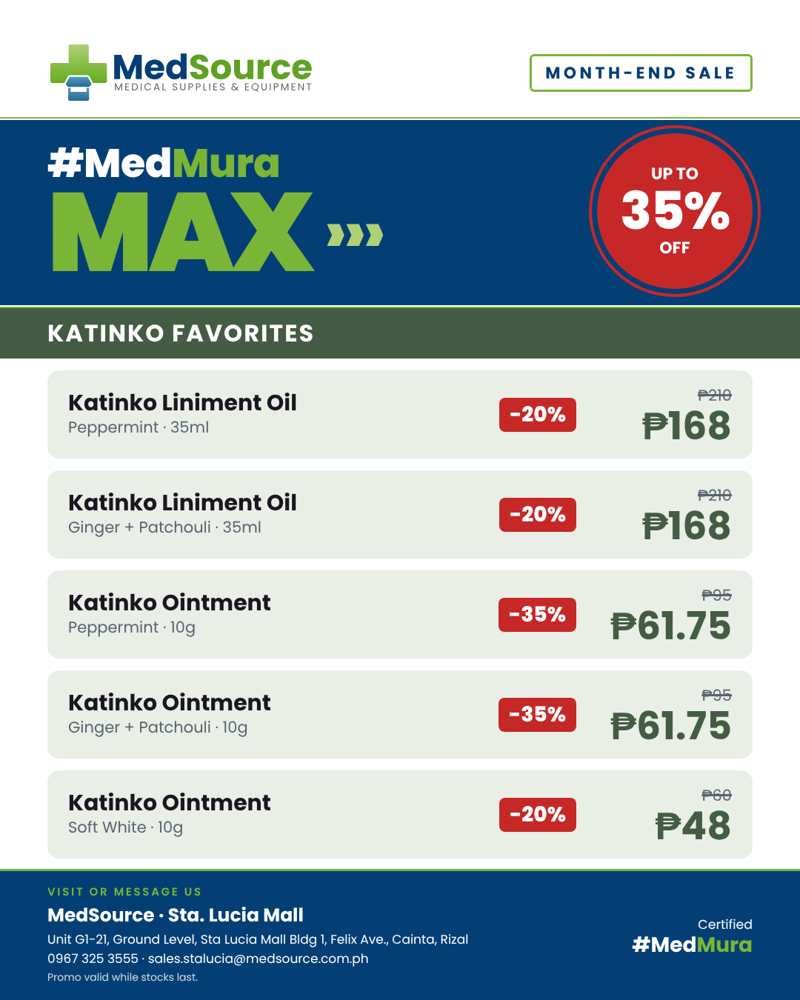
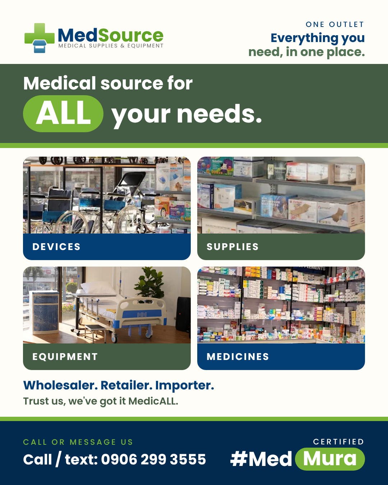
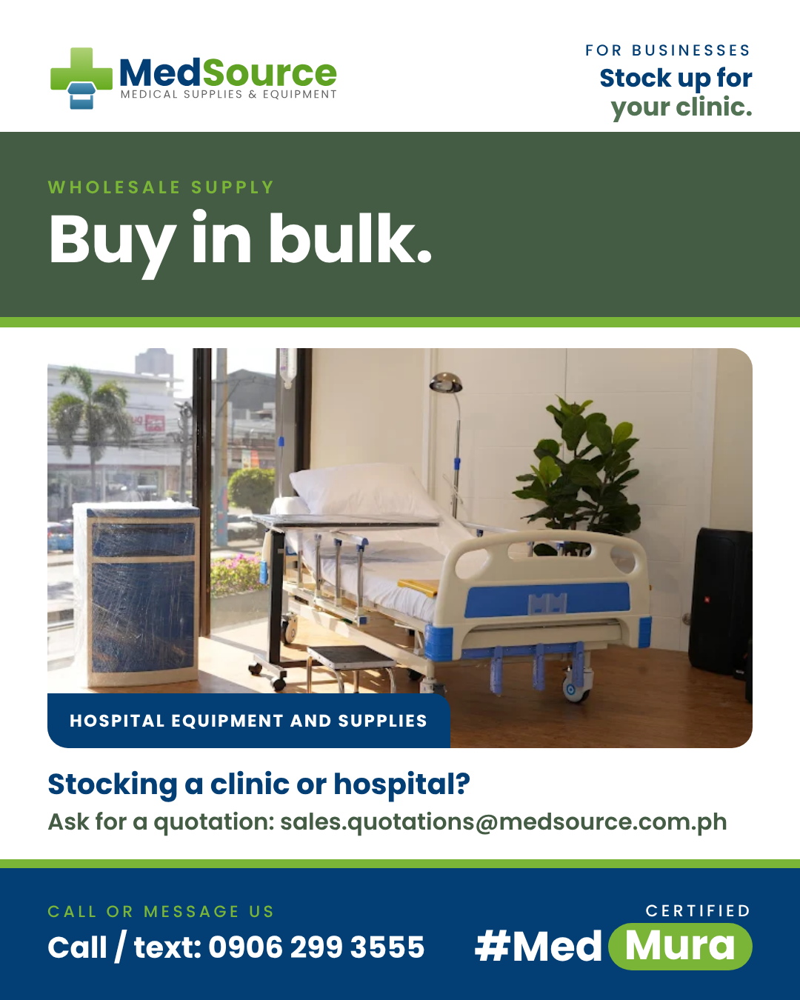
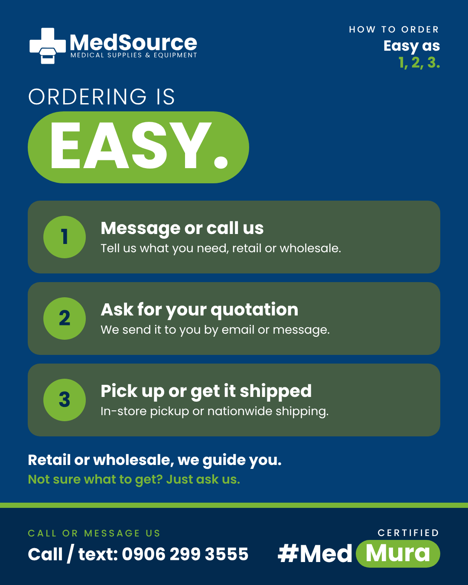
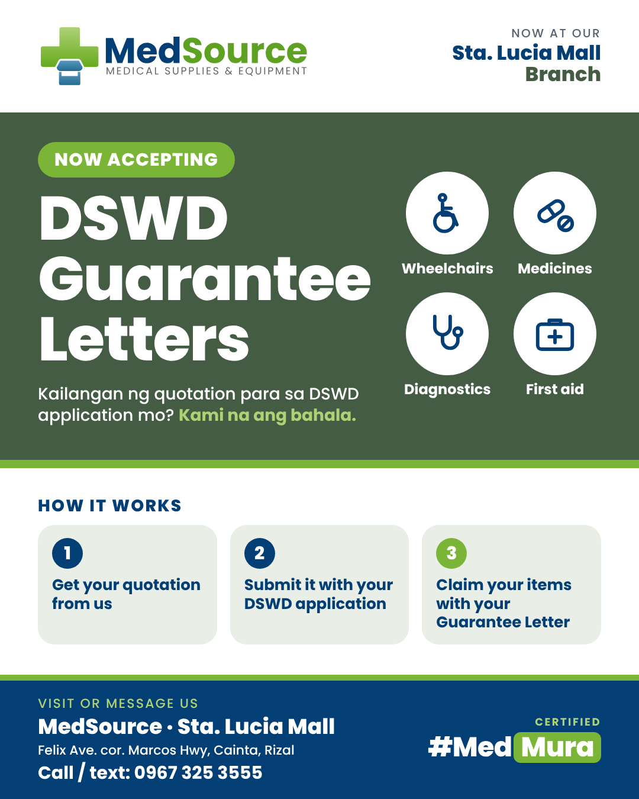
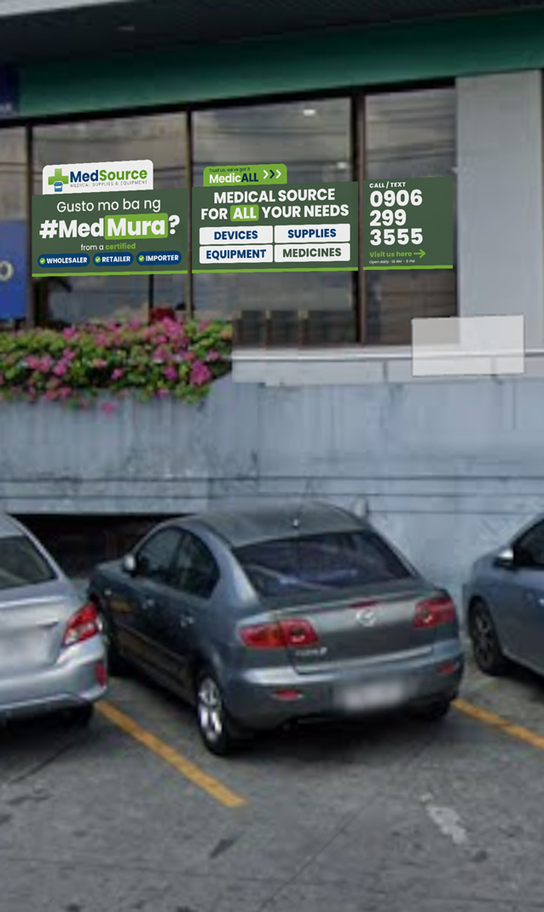

# MedSource Media

Letterheads follow the repo format: [LETTERHEAD-SPEC.md](../LETTERHEAD-SPEC.md).

Every MedSource publication in one place: social posts, signage and print, plus the logos. Images here are public so Metricool can schedule them. Brand rules live in the [MedSource Design System](https://claude.ai/artifact/LojEEUnecRaNcobaZvbXQ8). Part of [Brand Media](../README.md). MedSource is the only brand scheduled through Metricool.

## Social posts

| Date | Publication | Branch | Status | Preview |
| --- | --- | --- | --- | --- |
| Oct 27, 2026 | [#MedMura MAX: Month-End Deals (carousel)](posts/2026-10-27-medmura-max-katinko/post.md) | Sta. Lucia Mall | Scheduled |  |
| Oct 25, 2026 | [One Outlet Recap](posts/2026-10-25-one-outlet-recap/post.md) | Digital sales | Scheduled |  |
| Oct 23, 2026 | [Accredited](posts/2026-10-23-accreditations/post.md) | Sta. Lucia Mall | Scheduled |  |
| Oct 21, 2026 | [Wholesale for Clinics](posts/2026-10-21-wholesale-clinics/post.md) | Digital sales | Scheduled |  |
| Oct 19, 2026 | [How to Order](posts/2026-10-19-how-to-order/post.md) | Digital sales | Scheduled |  |
| Oct 12, 2026 | [Facebook Cover: #MedMura is now in the Philippines](posts/2026-10-12-facebook-cover/post.md) | Digital sales | Approved |  |
| Oct 13, 2026 | [Medicines](posts/2026-10-13-medicines/post.md) | Digital sales | Scheduled |  |
| Oct 11, 2026 | [Devices & Equipment](posts/2026-10-11-devices-equipment/post.md) | Digital sales | Scheduled |  |
| Oct 9, 2026 | [Wholesaler. Retailer. Importer.](posts/2026-10-09-wholesaler-retailer-importer/post.md) | Digital sales | Scheduled |  |
| Oct 8, 2026 | [Now Accepting DSWD Guarantee Letters](posts/2026-10-08-dswd-guarantee-letters/post.md) | Sta. Lucia Mall | Scheduled |  |

## Signage & print

| Date | Piece | Location | Status | Preview |
| --- | --- | --- | --- | --- |
| Oct 22, 2026 | [Warehouse Window Sticker v2](print/2026-10-warehouse-window-sticker-v2/print.md) | Warehouse glass wall | Approved |  |
| Oct 10, 2026 | [DSWD Tarpaulin 2 x 5 ft](print/2026-10-dswd-tarpaulin/print.md) | Sta. Lucia Mall | Draft |  |
| Oct 13, 2026 | [MedSource Digital Sales Letterhead Template](print/2026-10-medsource-letterhead-template/print.md) | Digital sales | Draft |  |
| Oct 10, 2026 | [Legal Government Letterhead Template](print/2026-10-legal-letterhead-template/print.md) | MedSource World, Marikina City | Draft |  |
| Oct 2026 | [Warehouse Window Sticker](print/2026-10-warehouse-window-sticker/print.md) | Warehouse glass wall | Superseded by v2 |  |

## Brand kit

Everything needed for flyers, tarps, documents and posts. Every logo comes as SVG (vector, send this to printers) and PNG (2000px wide, for Canva, Word and quick use).

| MedSource landscape | MedSource portrait | MedSource icon | MedSource World | World icon |
| --- | --- | --- | --- | --- |
|  |  |  |  |  |

- [`brand/logos/medsource`](brand/logos/medsource): official MedSource logos (landscape, portrait, icon), full colour and white
- [`brand/logos/medsource-world`](brand/logos/medsource-world): official MedSource World logo and globe icon, full colour and white
- [`brand/logos/mds`](brand/logos/mds): MDS Medical Scrubs & Apparel (scrub suit sub-brand) logos, monotone Slate, with white, chest mark, icon and colour alternates. Not tied to the MedSource colours
- [`brand/logos/signage`](brand/logos/signage): rebalanced logos for big-format signage only (larger wordmark), never for documents or posts
- [`brand/fonts/poppins`](brand/fonts/poppins): Poppins, the only MedSource brand font (Light to Black, with italics; free licence in OFL.txt)
- [`brand/fonts/mds`](brand/fonts/mds): Jost and Cormorant Garamond Italic, MDS only
- [`brand/guidelines`](brand/guidelines): brand guide, publication rules, decisions log and colour/type tokens; MDS has its own [`mds-brand-guide.md`](brand/guidelines/mds-brand-guide.md) and [`mds-tokens.json`](brand/guidelines/mds-tokens.json) (design system: [MDS](https://claude.ai/artifact/3GncLT8mqmQqy26hmRNCtP))

**Colours:** Forest `#445C44` · Navy `#033F75` · Brand green `#7AB537` · Navy deep `#022A4F` · White `#FFFFFF`
**Taglines:** Certified #Med**Mura** · Trust us, we've got it Medic**ALL**
**Rules:** white logo on forest, navy or photos; full colour on white only. No em dashes in any copy.

## Folder guide

- `posts/YYYY-MM-DD-slug/`: feed (1080×1350) and story (1080×1920) PNGs plus `post.md` with captions and schedule
- `print/YYYY-MM-slug/`: print-ready PDFs at actual size, mockups and `print.md`
- `brand/`: logos, fonts and guidelines
