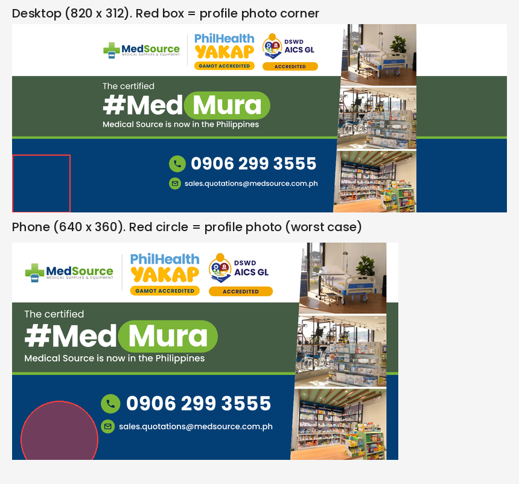

# Facebook Cover: #MedMura is now in the Philippines

| | |
| --- | --- |
| Date | Oct 12, 2026 |
| Type | Facebook cover (1640 × 624) |
| Branch | None (digital sales, 0906 299 3555) |
| Status | Approved |
| Design | Built from the MedSource Design System as HTML, see [`source/cover.html`](source/cover.html) |

Page cover announcing "The certified #MedMura, Medical Source is now in the Philippines". Forest headline band with the green Mura pill, navy contact footer (0906 299 3555, sales.quotations@medsource.com.ph), PhilHealth YAKAP and DSWD AICS GL accreditation badges beside the logo, and a slim diagonal photo column with the hospital bed, equipment and pharmacy shelves.

Not scheduled: a cover is uploaded by hand on the Facebook page, so there is no Metricool post, story or captions.

## Device fit

Facebook shows one cover at 820 × 312 on desktop and 640 × 360 on phones, which trims the sides, and the page profile photo covers the bottom-left corner. The file is 1640 × 624 (2x desktop). Phone-first rules used:

- Everything essential sits in x 300 to 1340 and y 30 to 595, inside the phone-safe centre.
- The bottom-left corner (x under 500, y over 390) is left empty for the profile photo, so the phone number and email start at x 520.
- Type is kept large (phone number 56 px, headline 88 px) because the cover shrinks to about a third of its size on phones.
- All three photos sit in a slim slash column inside the safe zone.

See [`device-preview.png`](device-preview.png) for the desktop and phone crops with the profile photo overlay.

## Image

## Accreditation badges

- **PhilHealth YAKAP:** the wordmark was cropped from the banner EJ supplied and stacked (PhilHealth over YAKAP) into a compact lockup, with a yellow "Gamot Accredited" pill. The stacked lockup is a rearrangement, not an official PhilHealth layout.
- **DSWD AICS GL:** the AICS emblem supplied by EJ, with "DSWD AICS GL" set beside it and an "Accredited" pill. Third-party logos are used here by EJ's explicit request, as an exception to the usual no-other-organizations'-logos rule.

## Source

`source/cover.html` renders the cover with `source/render.py` (Playwright, 1640 × 624). It reads Poppins and the MedSource logo from `../../../brand`. Photos are EJ's own store photos (bed display, pharmacy shelves, equipment and wheelchairs).
