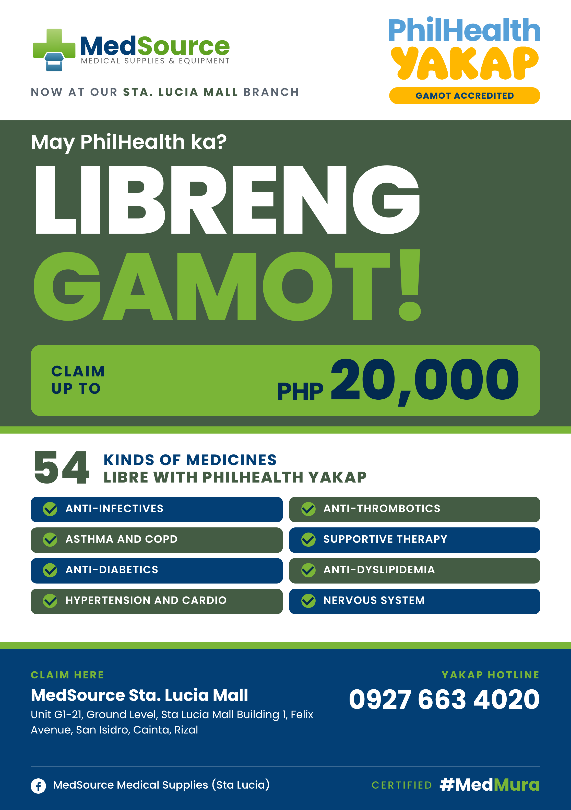

# PhilHealth YAKAP "Libreng Gamot" Flyer

| | |
| --- | --- |
| Date | Nov 9, 2026 |
| Type | Print, flyer (for flyering, offline only) |
| Size | A5, 148 x 210 mm portrait |
| Branch | Sta. Lucia Mall (YAKAP hotline 0927 663 4020) |
| Status | Approved |
| Design | [source-sta-lucia.html](source-sta-lucia.html), branch template [template.html](template.html) |

Revamp of the old "Libreng Gamot" PhilHealth YAKAP flyer into the current MedSource look: logo and PhilHealth YAKAP Gamot Accredited badge on white, forest hero band with "May PhilHealth ka? LIBRENG GAMOT!", green "Claim up to PHP 20,000" block, "54 kinds of medicines" with the 8 covered categories as tiles, navy footer with branch, phone, Facebook page and "Certified #MedMura". Poppins only, vector logos.

Offline flyering only. It names medicine classes, which Facebook ads block; use the separate ad-safe version for Meta ads.

## Print files (vector PDF, actual size)

| File | Size |
| --- | --- |
| [flyer-sta-lucia-A5-148x210mm.pdf](flyer-sta-lucia-A5-148x210mm.pdf) | 148 x 210 mm, fonts embedded, vector |

Layout at 96 px per inch (559 x 794 px), 30 px (about 8 mm) side margin. No bleed added: ask the printer if they need 3 mm and extend the bands.

## Preview

## Copy

- Now at our Sta. Lucia Mall branch
- May PhilHealth ka? LIBRENG GAMOT!
- Claim up to PHP 20,000
- 54 kinds of medicines libre with PhilHealth YAKAP: Anti-infectives, Anti-thrombotics, Asthma and COPD, Supportive therapy, Anti-diabetics, Anti-dyslipidemia, Hypertension and cardio, Nervous system
- Claim here: MedSource Sta. Lucia Mall, Unit G1-21, Ground Level, Sta Lucia Mall Building 1, Felix Avenue, San Isidro, Cainta, Rizal
- YAKAP hotline 0927 663 4020 · MedSource Medical Supplies (Sta Lucia) · Certified #MedMura

## Notes

- "54 kinds" is from the original flyer. News reports since Aug 2025 put the GAMOT list at 75 medicines; confirm before reprinting.
- New branch version: copy template.html, fill the {{...}} fields, render to PDF at 148 x 210 mm.
- Nov 9, 2026: phone changed to the YAKAP hotline 0927 663 4020 (used on everything YAKAP related, tied to the Sta. Lucia main branch).
